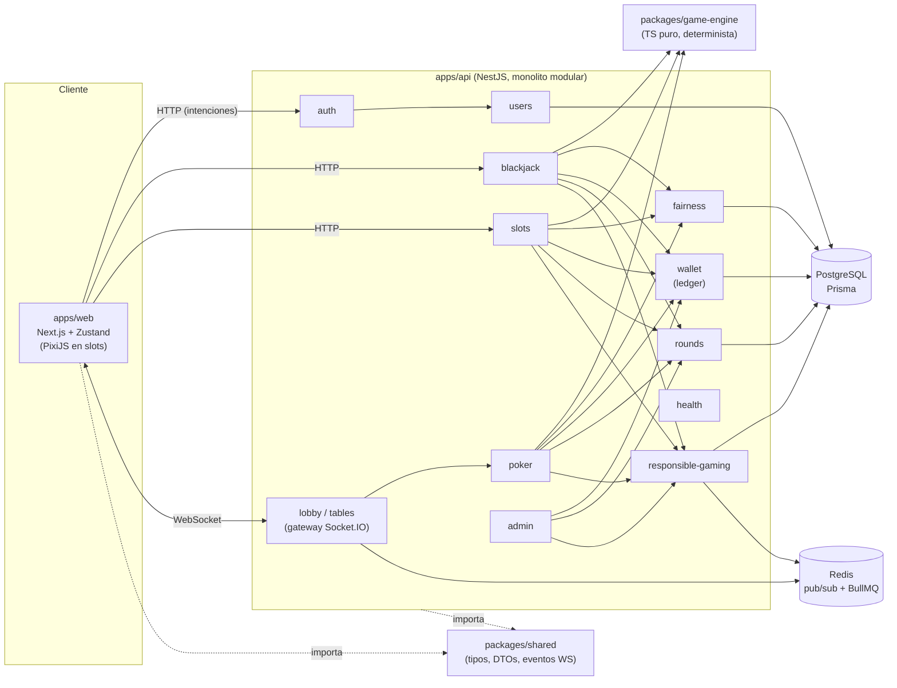
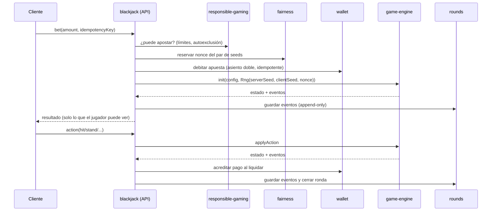

# Arquitectura

Casino de fichas virtuales diseñado como lo haría un casino real: el servidor decide, todo queda registrado y todo es auditable.

## Principios

1. **Servidor autoritativo.** El cliente envía intenciones (`apostar 100`, `pedir carta`) y recibe resultados. Nunca calcula resultados ni saldos que el servidor vaya a aceptar.
2. **Motor determinista y puro.** `packages/game-engine` no hace I/O, no lee el reloj y no usa `Math.random`. Mismo estado + misma acción + misma secuencia del `Rng` ⇒ mismo resultado. Eso permite tests de propiedades, simuladores de RTP y reproducción de rondas.
3. **Ledger inmutable de doble entrada.** El saldo nunca se edita: se registran asientos que suman cero. Cada operación es idempotente (`idempotencyKey`). Ver [ADR-002](ADRs/ADR-002-ledger-doble-entrada.md).
4. **Rondas como eventos.** Una ronda es una lista ordenada y _append-only_ de `RoundEvent`. Reproducirla reconstruye el estado exacto (auditoría, soporte, disputas).
5. **Provably fair.** El jugador recibe el hash del `serverSeed` antes de jugar y puede verificar cada ronda después de la rotación. Ver [ADR-003](ADRs/ADR-003-rng-provably-fair.md).
6. **Monolito modular.** Un módulo por dominio, dependencias explícitas, sin acceso directo a tablas de otro módulo. Ver [ADR-001](ADRs/ADR-001-monolito-modular.md).
7. **Solo fichas virtuales.** Sin dinero real, pagos ni KYC.

## Componentes

## Flujo de una apuesta (blackjack, esquema)

Todo el paso `debitar → registrar → acreditar` ocurre con consistencia garantizada por transacciones de PostgreSQL y claves de idempotencia (detalles en la Fase 1/2).

## Responsabilidades por módulo (`apps/api/src/modules`)

| Módulo               | Responsabilidad                                                                                      | Fase |
| -------------------- | ---------------------------------------------------------------------------------------------------- | ---- |
| `health`             | Liveness (y luego readiness: PostgreSQL y Redis). **Implementado.**                                  | 0    |
| `auth`               | Registro, login, JWT, refresh tokens rotatorios, guards y roles. **Implementado.**                   | 1    |
| `users`              | Perfil y consulta de usuarios. **Implementado.**                                                     | 1    |
| `wallet`             | Ledger de doble entrada, saldos, transferencias idempotentes, reconciliación. **Implementado.**      | 1    |
| `fairness`           | Pares de seeds: compromiso (hash), rotación, revelado y verificación.                                | 2    |
| `rounds`             | Persistencia append-only de eventos de ronda, reproducción y auditoría.                              | 2    |
| `blackjack`          | Orquesta una ronda: límites → nonce → débito → motor → eventos → pago.                               | 2    |
| `lobby` (+ gateway)  | Registro de mesas, presencia y difusión en tiempo real por Socket.IO.                                | 3    |
| `slots`              | Orquesta giros usando el motor genérico de slots.                                                    | 4    |
| `poker`              | Texas Hold'em cash multijugador: asientos, buy-in vía ledger, turnos con temporizador, botes y rake. | 6    |
| `responsible-gaming` | Límites (depósito de fichas, pérdida, tiempo), pausas y autoexclusión; veto previo a apostar.        | 5\*  |
| `admin`              | Backoffice: consulta de usuarios, auditoría de ledger, inspector de rondas, configuración.           | 5    |

\* La **interfaz de veto** (`canBet`) se define en la Fase 1 y se invoca desde la Fase 2 con una implementación mínima; la funcionalidad completa llega en la Fase 5. Así no hay que retocar todos los juegos después.

### Reglas de dependencia

- `game-engine` no depende de nada del repositorio (ni de Nest, ni de Prisma, ni de `shared`).
- `shared` no tiene dependencias en runtime.
- Los módulos de juego (`blackjack`, `slots`) usan `wallet`, `fairness`, `rounds` y `responsible-gaming` solo a través de sus servicios exportados.
- Solo `wallet` escribe en `LedgerEntry`/`Account`; solo `rounds` escribe en `GameRound`/`RoundEvent`; solo `fairness` escribe en `SeedPair`.
- Un módulo nunca hace `prisma.<tabla de otro módulo>`: si necesita datos de otro, llama a su servicio. Esto es lo que hace posible extraer servicios más adelante.

## Modelo de datos núcleo (`apps/api/prisma/schema.prisma`)

`User` → `Account` (saldo cacheado; cuentas de sistema `HOUSE` y `FAUCET`) ← `LedgerEntry` (patas inmutables, con `balanceAfter`) → `LedgerTransaction` (una por operación, `idempotencyKey` único) · `User` → `RefreshToken` (sesiones, ADR-004) · `GameRound` → `RoundEvent` (único por `roundId+seq`) · `SeedPair` (seeds y `nextNonce`; `GameRound` único por `seedPairId+nonce`).

Las invariantes que Prisma no puede expresar están en SQL dentro de la migración inicial: `CHECK` de saldo no negativo para jugadores e importes positivos, triggers append-only, un trigger diferido que exige que cada transacción cuadre, y la unicidad de las cuentas de sistema.

Los importes son `BigInt` (fichas enteras). En JSON viajan como cadenas.

## Tiempo real

Socket.IO desde NestJS (`lobby.gateway.ts`). Los nombres de evento viven en `packages/shared` (`WS_EVENTS`). Para escalar horizontalmente se usará el adaptador de Redis (Fase 3). El estado autoritativo de una mesa vive en el servidor; los clientes reciben instantáneas y eventos.

## Calidad y entorno

- Tests: Vitest en cada workspace; fast-check para propiedades (ledger, y en el motor: conservación de fichas, rango del RNG, reproducibilidad). `pnpm test` solo ejecuta tests unitarios (no necesita Docker). `pnpm test:integration` arranca la API completa contra PostgreSQL real, en una base `*_test` propia, y exige cobertura ≥ 90 % en `wallet`.
- Transversal (`apps/api/src/common`): logs JSON con pino y `x-request-id` (se reutiliza el entrante o se genera; aparece en los logs y en los errores), `ValidationPipe` global (rechaza propiedades desconocidas), filtro de errores con códigos estables (`ApiErrorDto`), helmet, CORS con credenciales y rate limiting por IP (más estricto en las rutas de credenciales).
- Lint/formato: ESLint 9 (config plana compartida) y Prettier; Husky + lint-staged en pre-commit.
- CI: GitHub Actions (`.github/workflows/ci.yml`): format, lint, build, typecheck, tests unitarios y tests de integración con un servicio PostgreSQL.
- Local: `docker-compose.yml` con PostgreSQL 17 y Redis 7.
